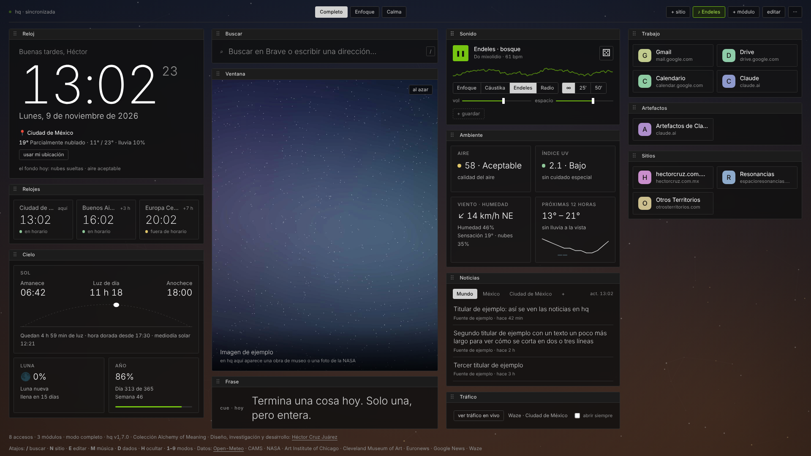
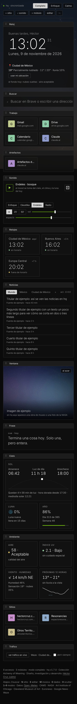
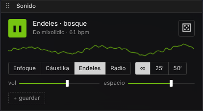
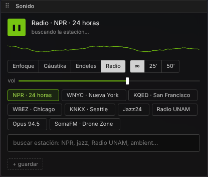
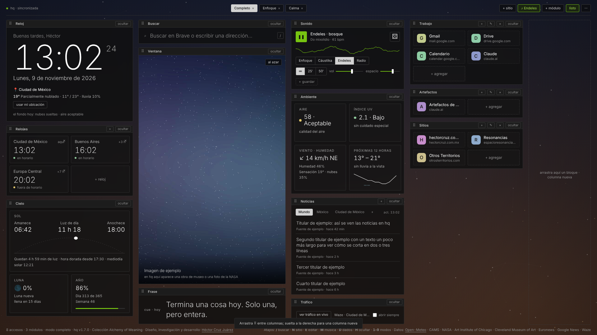
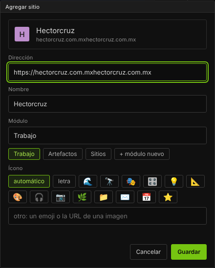
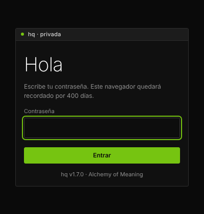

# hq

**v1.7.0** · Página de inicio personal y base de operaciones · Colección *Alchemy of Meaning (Alquimia del Significado)*

## Español

hq es una página de inicio privada para el navegador y el teléfono. Reúne en un solo lugar los accesos a tus sitios y herramientas, la hora en varias ciudades, el cielo y el clima del lugar donde estás, noticias, una ventana de imágenes y música procedural para concentrarse. Vive en tu propio hosting con PHP y está protegida con contraseña.

### Qué hace

- **Tablero sin scroll en escritorio.** En una pantalla horizontal (laptop, 1080p, 4K) todo se acomoda en columnas y se ajusta a la pantalla; en el teléfono se ve en una sola columna con su propio orden.
- **Accesos en módulos.** Se agregan arrastrando el ícono de la barra de direcciones, pegando una dirección o con el botón «+ hq» de la barra de favoritos. hq lee el título y el ícono del sitio.
- **Modos.** Completo, Enfoque, Calma o los que guardes: cada uno recuerda qué bloques se ven y en qué orden.
- **Cielo y ambiente en vivo.** Amanecer, ocaso, luna, calidad del aire, índice UV, viento y mareas. El fondo animado cambia con la hora real del sol, el clima y el aire.
- **Ventana de imágenes.** Fotos de la NASA y obras de dominio público del Art Institute of Chicago y del Cleveland Museum of Art, elegidas según el cielo de ese momento.
- **Noticias.** Euronews, México y tu ciudad, más cualquier RSS que agregues.
- **Sonido.** Música procedural generada en el navegador (modos Enfoque, Cáustika y Endeles), con el mood tomado del clima, dados para cambiar la armonía, sonoridades guardadas y radio en internet.
- **Sincronización.** Accesos, módulos, modos y sonoridades se guardan en tu servidor y se ven igual en todos tus dispositivos.

### Instalación

1. Sube la carpeta a tu hosting (PHP 7.4 o más), por ejemplo `tudominio.com/hq/`.
2. Abre esa dirección y crea la contraseña. Hazlo en cuanto la subas: quien entre primero la define.
3. La carpeta `datos/` debe poder escribirse. Ahí quedan la contraseña cifrada y tus accesos; no se sube al repositorio.
4. Pon la dirección como página de inicio de tu navegador.

La guía completa, con atajos de teclado y el historial de versiones, está en [LEEME.txt](LEEME.txt).

### Interfaz

Sigue el estilo **Alchemy of Meaning UI v1**: fondo negro, ventanas pequeñas con barra de título, líneas de 1 px, Inter 12 px y el verde solo para lo vivo (lo que suena, lo activo, el progreso). `h` oculta la interfaz y deja solo el cielo; en el menú «···» hay un contraste alto.

| Teléfono | Sonido | Radio |
|---|---|---|
|  |  |  |

| Editar | Agregar sitio | Acceso |
|---|---|---|
|  |  |  |

Las capturas usan datos de ejemplo: la imagen de la ventana es abstracta y los titulares son de prueba.

## English

hq is a private start page for the browser and the phone. It brings together shortcuts to your sites and tools, clocks for several cities, the sky and weather where you are, news, an image window and procedural focus music. It runs on your own PHP hosting behind a password.

### Features

- **Scroll-free dashboard on desktop.** On a landscape screen (laptop, 1080p, 4K) everything fits in columns and scales to the screen; on a phone it becomes a single column with its own order.
- **Shortcut modules.** Add sites by dragging the address-bar icon, pasting a URL or using the «+ hq» bookmarklet. hq reads each site's title and icon.
- **Modes.** Completo, Enfoque, Calma or your own: each remembers which blocks are shown and in what order.
- **Live sky and environment.** Sunrise, sunset, moon, air quality, UV index, wind and tides. The animated background follows the real sun, weather and air.
- **Image window.** NASA photos and public-domain works from the Art Institute of Chicago and the Cleveland Museum of Art, chosen to match the current sky.
- **News.** Euronews, Mexico and your city, plus any RSS feed you add.
- **Sound.** Procedural music generated in the browser (Enfoque, Cáustika and Endeles modes), with its mood taken from the weather, dice to re-roll the harmony, saved presets and internet radio.
- **Sync.** Shortcuts, modules, modes and presets are stored on your server and shared across devices.

### Install

1. Upload the folder to your hosting (PHP 7.4+), e.g. `yourdomain.com/hq/`.
2. Open it and create the password right away: whoever opens it first sets it.
3. The `datos/` folder must be writable. It holds the hashed password and your shortcuts and is never committed.
4. Set the address as your browser's home page.

The full guide (in Spanish), with keyboard shortcuts and the changelog, is in [LEEME.txt](LEEME.txt).

### Interface

It follows **Alchemy of Meaning UI v1**: black background, small windows with title bars, 1 px lines, Inter 12 px, and green only for what is live (playing, active, progress). Press `h` to hide the interface and leave only the sky; a high-contrast option is in the «···» menu.

The screenshots use sample data: the window image is abstract and the headlines are placeholders.

## Créditos · Credits

Diseño, investigación y desarrollo · Design, research and development: **Héctor Cruz Juárez** — https://hectorcruz.com.mx

Colección *Alchemy of Meaning (Alquimia del Significado)*.

Datos · Data: Open-Meteo (CC BY 4.0), Copernicus CAMS, NASA, Art Institute of Chicago, Cleveland Museum of Art (CC0), Euronews, Google News, Radio Browser, Waze.

## Licencia · License

GPL-3.0-or-later. Ver · See [LICENSE](LICENSE).
